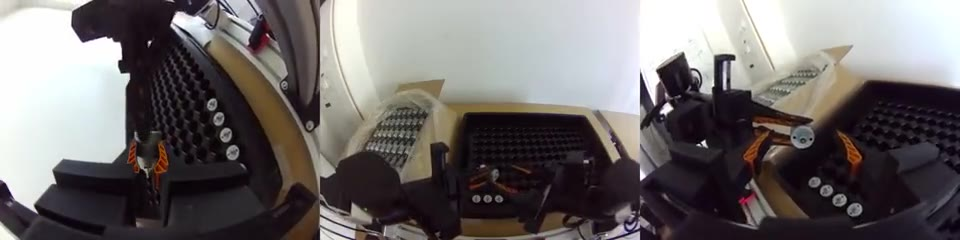
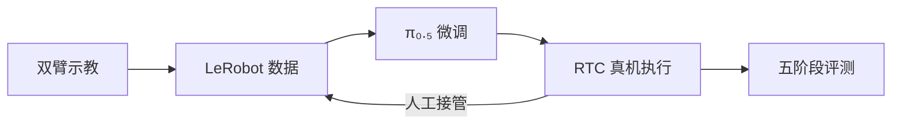

# π₀.₅ × TRLC-DK1 双臂拆箱

我在 TRLC-DK1 双臂工位上用 π₀.₅ 完成执行器拆箱。左臂从料箱取件并交接，右臂调整方向后将工件插入托盘。这里记录我的数据采集、策略训练和真机评测流程。

[](https://github.com/lixinpenga/pi05-dk1-unboxing/actions/workflows/test.yml)
[](LICENSE)

[Demo](docs/demos.md) · [实验与图表](docs/results.md) · [快速开始](#快速开始) · [部署与评测](docs/experiments.md)

## 真机演示

[](assets/demos/three-camera-demo.mp4?raw=true)

[三机位完整示教](assets/demos/three-camera-demo.mp4?raw=true) · [RTC 连续运行](assets/demos/rtc-continuous.mp4?raw=true) · [全部实验视频](docs/demos.md)

## 实验结果

| 设置 | 实际成功率 |
| --- | ---: |
| 21 小时示教，全参微调，默认 RTC | 91 / 120（75.8%） |
| 同一权重，调整 RTC | 74 / 80（92.5%） |
| 加 1 小时高质量示教续训，默认 RTC | 36 / 40（90.0%） |
| 同一续训权重，调整 RTC | 39 / 40（97.5%） |
| 1 小时高质量示教加 240 次运行收集的接管片段，标准摆放 | 35 / 40（87.5%） |

这些数字对应特定工位、摆放和试验轮数。[实验图表、评测口径和适用范围](docs/results.md)

## 任务与系统

| 场景 | 策略输入 | 控制输出 |
| --- | --- | --- |
| 顶层 40 件，9×15 托盘，固定取放顺序 | 左腕、右腕、顶视图像与 14 维关节状态 | 50 Hz 控制，50 步双臂动作块 |



## 快速开始

要求 Python 3.12，真机命令运行在 Linux。下方先安装 CPU 数据和控制逻辑所需的轻量依赖。

```bash
git clone https://github.com/lixinpenga/pi05-dk1-unboxing.git
cd pi05-dk1-unboxing
uv venv --python 3.12
source .venv/bin/activate
uv pip install -e '.[dev]'
dk1-unboxing smoke --output outputs/smoke
pytest -q
```

同时检查 LeRobot 写入和读回时，先安装 CPU 版 PyTorch 与 torchvision。

```bash
uv pip install 'torch==2.11.*' 'torchvision==0.26.*' \
  --index https://download.pytorch.org/whl/cpu --index-strategy unsafe-best-match
uv pip install -e '.[lerobot]'
dk1-unboxing smoke --lerobot --output outputs/smoke-lerobot
```

报告位于 `outputs/smoke-lerobot/report.json`。合成数据覆盖 HQ 示教、被过滤的低评分示教、单段人工纠偏和无接管成功。LeRobot 回读检查三张 224×224 RGB 图像与 `50×14` 动作块。这条测试使用模拟输入和延迟，不衡量插槽物理成功率。

## 文档

| 阶段 | 内容 |
| --- | --- |
| [采集与工位](docs/hardware.md) | 双臂配置、相机和夹爪校准、示教与人工接管 |
| [训练](docs/training.md) | 全参、HQ、DAgger、LoRA 配方及离线验证 |
| [实验与图表](docs/results.md) | 数据质量、训练消融、人工接管与 RTC |
| [部署与评测](docs/experiments.md) | 加载本地权重、对照两组 RTC 参数、汇总真机结果 |
| [实现说明](docs/implementation.md) | 输入输出、控制时序与评测口径 |
| [参与贡献](CONTRIBUTING.md) | 本地检查、错误报告与 PR |

离线测试覆盖数据导出与读回、动作块边界、RTC 切换与阶段评分。在新工位部署时，请校准设备并实测控制延迟与成功率。

代码采用 [Apache-2.0](LICENSE)。
