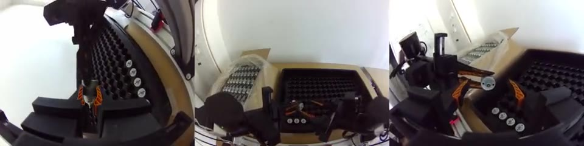
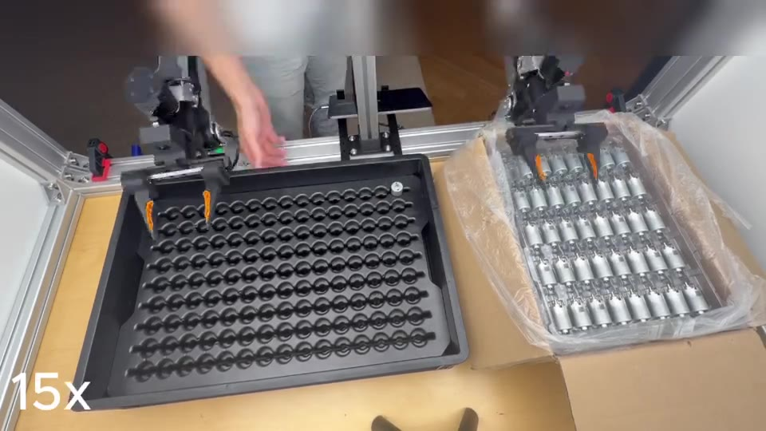

# 真机 Demo

[项目首页](../README.md) · [实验图表](results.md) · [评测流程](experiments.md)

## 完整示教与连续运行

| 三机位完整示教 | RTC 连续运行 |
| --- | --- |
|  |  |
| [播放 MP4](../assets/demos/three-camera-demo.mp4?raw=true) · 左腕、顶视、右腕 | [播放 MP4](../assets/demos/rtc-continuous.mp4?raw=true) · `reinfer=50`、`blend=20` |

三机位视频展示一次训练示教。连续运行使用在 21 小时基线之后额外用 1 小时高质量示教续训的策略。我在连续运行演示里省去了逐件回休息位的步骤，计分评测则保留了该步骤。视频中的速度标注沿用录制版本。

## 示教质量

我用下列片段校准质量评分，普通示教训练保留 3–5 分的回合。

| 分数 | 观察点 | 视频 |
| --- | --- | --- |
| 1 | 无法恢复的失败 | [播放](../assets/demos/quality-1.mp4?raw=true) |
| 2 | 明显失误，需要大幅纠正 | [播放](../assets/demos/quality-2.mp4?raw=true) |
| 3 | 有轻微失误 | [播放](../assets/demos/quality-3.mp4?raw=true) |
| 4 | 整体有效，仍有小幅修正 | [播放](../assets/demos/quality-4.mp4?raw=true) |
| 5 | 完成过程干净 | [播放](../assets/demos/quality-5.mp4?raw=true) |

## 五阶段评分

以下视频按达到的最远阶段排列。每一阶段都要求满足前序条件。

| 阶段 | 判定 | 视频 |
| --- | --- | --- |
| 1 | 未抬起正确工件 | [播放](../assets/demos/stage-1.mp4?raw=true) |
| 2 | 抬起正确工件 | [播放](../assets/demos/stage-2.mp4?raw=true) |
| 3 | 完成交接，右臂持件至少 1 秒 | [播放](../assets/demos/stage-3.mp4?raw=true) |
| 4 | 工件两侧进入正确槽位，仍有倾斜或方向不正确 | [播放](../assets/demos/stage-4.mp4?raw=true) |
| 5 | 方向正确，完整入槽 | [播放](../assets/demos/stage-5.mp4?raw=true) |

## 对照片段

| 对照 | 观察点 | 视频 |
| --- | --- | --- |
| Gello 与 VR 示教训练 | 左侧交接失败，右侧交接成功。观察两臂接近与松夹时机。 | [播放](../assets/demos/handover-comparison.mp4?raw=true) |
| 常规与高质量示教 | 对照接近槽口时的速度、上下对齐和工件姿态。 | [播放](../assets/demos/collection-comparison.mp4?raw=true) |
| 从视觉语言主干初始化 | 观察缺少机器人动作预训练时的三机位执行表现。 | [播放](../assets/demos/initialization-rollout.mp4?raw=true) |
