# π₀.₅ 双臂拆箱实验

[项目首页](../README.md) · [真机 Demo](demos.md) · [运行实验](experiments.md)

我在 TRLC-DK1 双臂工位上研究了三件事：模型需要多少训练，怎样采集更有价值的数据，以及在不改权重的情况下怎样提高真机成功率。以下图表保留各组实验的分母。百分比按各图标示取整，正文中的关键结果同时给出原始计数。

## 任务与评测

左臂从纸箱取出执行器并交给右臂，右臂定向后插入 9×15 托盘。纸箱顶层有 40 件。每轮按固定顺序评测 40 件，工件触点朝下，两种相差 180° 的朝向都可以。策略以 50 Hz 推理执行链路下发关节与夹爪目标，单个动作块包含 50 步。

我按五个阶段记录进度：未取到正确工件、正确取件、稳定交接、部分入槽、完整入槽。完整入槽计成功。每件最长运行 45 秒，连续 10 秒没有进展时提前结束。柱状成功率图标示 95% Wilson 区间。评测起始摆放、回合数和是否逐件回休息位决定结果的可比性。[五阶段视频](demos.md#五阶段评分) · [评分和操作流程](experiments.md)

## 数据采集与筛选

我记录了顶视、左腕和右腕三路 640×480 图像，以及 14 维关节与夹爪状态和动作。普通示教按 1–5 分标注，训练保留 3–5 分。导出时裁掉回合首尾空闲段，并将图像中心裁剪至 224×224。全参基线使用约 21 小时的数据，包含 7,271 个回合。

### 示教质量与回合时长

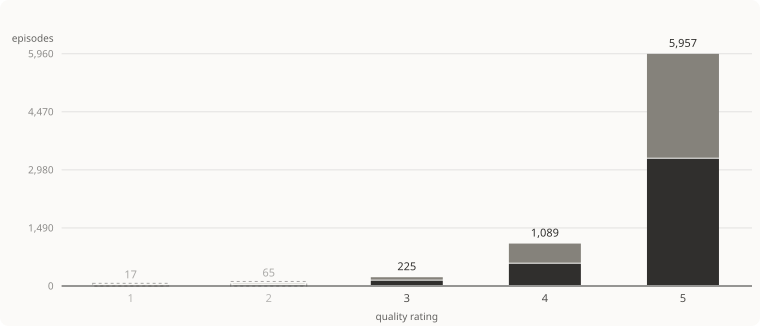

虚线柱标出筛掉的数据。质量分数描述示教中的失误和纠偏程度。[质量评分片段](demos.md#示教质量)

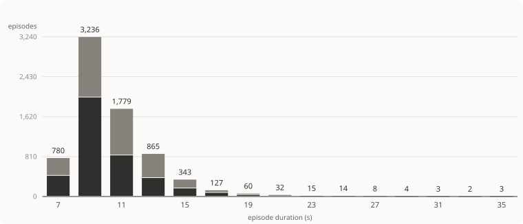

时长按 2 秒分箱。图中记录的是裁去首尾空闲段之后用于训练的时长。

### 数据量、场景和采集方式

在我测试的配方下，从 4 小时扩展至 21 小时，端到端成功率从 50/80 提高到 91/120。


固定采集约 4 小时，单一灯箱数据为 13/40，五场景数据为 50/80。五个场景包括四个桌面布置和一个灯箱，灯箱同时作为计分工位。


我也比较了 VR、Gello 和混合采集三组，成功计数分别是 49/80、12/40 和 51/80。采集方式与示教来源同时变化，两者的贡献无法在这组实验中分开估计。[交接对照视频](demos.md#对照片段)


## 训练配方与消融

全参基线使用 21 小时示教、EBS 256 和峰值学习率 `5e-5`，进行 50,000 次优化器更新。细节见[训练手册](training.md)。

### 训练时长与离线验证

我沿一条 210k 更新的训练轨迹做 checkpoint 评测，每个 checkpoint 跑 40 次。成功率较早进入平台期，继续训练并没有显示稳定上升。离线动作误差与真机成功率有一定关联，但单靠这一指标难以区分表现接近的 checkpoint。图中的拟合仅对应这一条训练轨迹。



### 全参微调与 LoRA

我比较了两个 LoRA rank 和不同 EBS。rank 64 两组分别为 18/40 和 13/40，rank 256 为 21/40。全参基线为 91/120。rank 256 比其中两组少看约一半训练样本，因而这组结果还不能分离 rank、训练预算和 EBS 的影响。


### 学习率、批量、动作表示与增强

我没有在所测试的学习率或有效批量范围内看到稳定提升。高学习率曾取得更低的训练损失，但真机成功率更低。相对关节目标和图像增强也未在本次样本量下显示明确收益。

| 学习率与训练损失 | 有效批量与动作表示 |
| --- | --- |
|  |  |
| 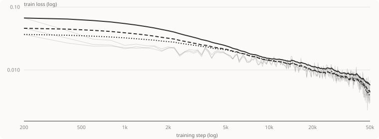 |  |

### 预训练初始化

只从视觉语言主干初始化时，我在 40 个评测回合里没有观察到完整插入。使用 π₀.₅ 预训练初始化的基线为 91/120。[三机位初始化对照](demos.md#对照片段)


## 高质量示教与人工接管

我另外采集了 1 小时高质量示教，要求操作速度一致，并让工件干净地进入槽位。只用这 1 小时训练得到 11/40。在 21 小时基线的 checkpoint 上用它续训，默认 RTC 下得到 36/40。这里的时间是示教数据时长。[采集对照视频](demos.md#对照片段)


随后我让小数据策略运行 240 回合，在出现错误趋势时人工接管，212 回合有接管。我把人工动作片段、无接管成功回合和原有高质量示教合并后重新训练。标准摆放下从 11/40 提高到 35/40，变化摆放下从 21/200 提高到 19/40。标准和变化摆放须分别比较。


## RTC 在线执行

我在冻结权重的情况下对照部署参数。默认设置在剩余 30 步时发起新推理，前缀引导长度为 16 步。新动作块返回时，控制器按已流逝的控制周期跳过过期索引，利用前缀引导减少交接处的突变。


在 21 小时基线权重上，把重新推理阈值和前缀引导长度改为 50 和 20，真机结果从 91/120 提高到 74/80。对 22 小时续训权重使用同一参数，结果是 39/40。该配置下连续运行的片段单独展示。[连续运行视频](demos.md#完整示教与连续运行)


## 图像增强示例

增强试验从亮度、对比度、饱和度、色相、锐度和小幅仿射中随机抽取三个变换并按固定顺序应用。以下顶视图展示单独变化和叠加效果。

| 原图 | 亮度 | 对比度 | 饱和度 |
| --- | --- | --- | --- |
|  | 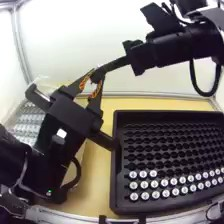 | 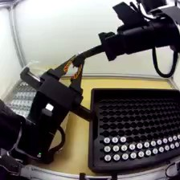 |  |

| 色相 | 锐度 | 仿射 |
| --- | --- | --- |
| 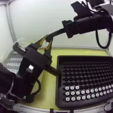 | 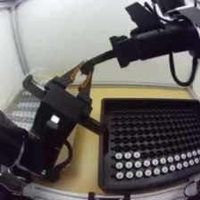 | 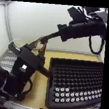 |

| 随机组合 1 | 随机组合 2 | 随机组合 3 |
| --- | --- | --- |
| 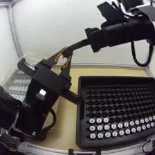 | 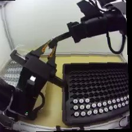 | 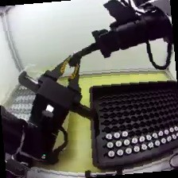 |

| 随机组合 4 | 随机组合 5 |
| --- | --- |
| 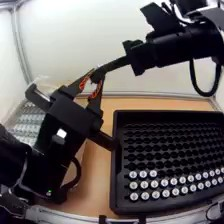 | 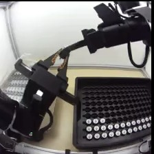 |

## 适用范围

这些结果来自同一类双臂工位、执行器与托盘。若更换硬件、相机布局、工件形态或放置分布，我会重新采集数据并执行同样的分阶段评测。图表和视频记录了实验结果，仓库的离线测试用于验证代码路径和时序逻辑。
