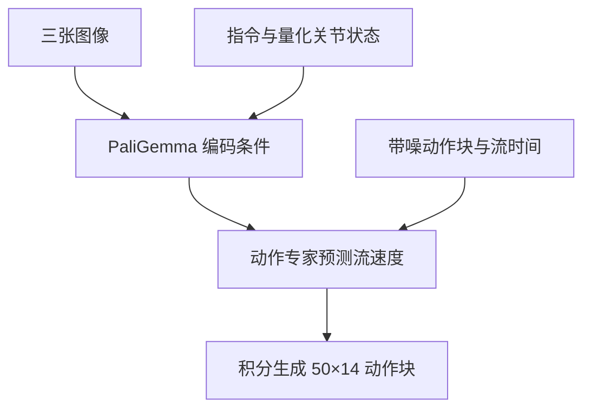

# π₀.₅ 微调与实验配方

## 损失、输入与输出

一个样本包含三张 224×224 RGB 图像、14 维状态、任务指令及从当前帧开始的 50 帧关节与夹爪目标。动作块不会跨越回合边界。LeRobot 在边界重复末帧并提供填充掩码，离线动作误差排除填充位置。



SigLIP 编码图像。LeRobot 用状态和动作各自的 1% 与 99% 分位数缩放数值。π₀.₅ 把归一化状态离散为文本提示的一部分。任务指令沿用公开数据的英文字符串。

训练用 `x_tau = tau × noise + (1 − tau) × action` 插值高斯噪声与示教动作。监督速度为 `noise − action`，目标为速度预测的均方误差。流时间从 Beta(1.5, 1.0) 采样后轻微缩放。部署用 10 步积分从噪声还原动作块，再反归一化为 SDK 关节单位。RTC 在同一去噪过程中引导新块与上次预测重叠，控制器继续执行旧块，收到新块后裁去已经过去的索引。[OpenPI](https://github.com/Physical-Intelligence/openpi) · [LeRobot π₀.₅](https://huggingface.co/docs/lerobot/main/en/pi05) · [RTC](https://arxiv.org/abs/2506.07339)

## 全参基线

将本地 π₀.₅ 初始权重放到 `weights/initial`，或将 `--init` 替换为你指定的模型仓库 ID。数据集 ID 通过 `--dataset` 传入。使用本地数据时同时传入 `--dataset-root`。

| 配置 | 值 |
| --- | --- |
| 数据与初始化 | LeRobot v3 数据，初始权重通过 `--init` 提供 |
| 优化器 | AdamW，betas (0.9, 0.95)，eps 1e-8，weight decay 0.01，梯度裁剪 1.0 |
| 有效批量 | 4 卡 × 每卡 8 × 累积 8 = 256 |
| 更新总数 | 50,000 次 |
| WSD | 1,500 更新线性 warmup、38,500 更新稳定、10,000 更新二次衰减 |
| 学习率 | 峰值 `5e-5`，下限 `2.5e-6` |
| 并行 | 单机 4 卡 DDP，每卡完整权重，累积最后一个 microbatch 同步梯度 |
| 内存 | BF16、激活检查点，预设默认 eager，`--compile-model` 可对照实验的编译设置 |
| 保存和验证 | 通常每 10k 次更新保存权重、处理器、优化器与调度器，在约 5% 留出的回合计算流损失 |

本配置以单机 4×H100 80 GB 为目标。具体批量和调度参数见 [recipes.yaml](../configs/recipes.yaml)。

CLI 的步数为优化器更新。锁定的新版 LeRobot 训练循环每个 microbatch 计一步，因此同时换算 WSD、验证及保存间隔。默认累积 8 时，50k 更新对应 400k 个循环步。调度器在衰减段使用 `lr_min + (lr_peak - lr_min) × (1 - progress)^2`，checkpoint 名称采用循环步数。最终权重可通过 `checkpoints/last/pretrained_model` 定位。

```bash
dk1-unboxing train baseline --dataset local/dk1-baseline --dataset-root data/baseline \
  --init weights/initial --output outputs/gpu-smoke \
  --updates 20 --warmup 2 --decay 4 --eval-every 0 --save-every 0

dk1-unboxing train baseline --dataset local/dk1-baseline --dataset-root data/baseline \
  --init weights/initial --output outputs/baseline
dk1-unboxing resume --gpus 4 \
  --checkpoint outputs/baseline/checkpoints/last/pretrained_model/train_config.json

dk1-unboxing offline-eval --dataset local/dk1-baseline --dataset-root data/baseline \
  --checkpoint outputs/baseline/checkpoints/last/pretrained_model --max-anchors 128
```

改用每卡 microbatch 4 时梯度累积会变为 16。短跑可检查数据吞吐、显存与 checkpoint。离线误差是每个有效时步 14 维误差的 L2 均值。用本地数据训练时，导出自同一个原始回合的干预片段进入切分的同一侧。公开干预数据缺少本仓库的原始回合清单，按导出回合切分。

## 高质量示教与人工接管

| 目标 | 配方 |
| --- | --- |
| 高质量示教训练 | `train hq` |
| 人工接管数据训练 | `train dagger` |
| 全参训练 | `train baseline` |
| 从已有权重续训 | `train hq-continue --init <checkpoint>` |

先使用 HQ 模型采集人工纠偏，再用合并后的数据训练。通过 `--init` 提供初始 π₀.₅ 权重。续训时通过 `--init` 传入本地 checkpoint。

```bash
dk1-unboxing train hq --dataset local/dk1-hq --dataset-root data/hq \
  --init weights/initial --output outputs/hq
dk1-unboxing train hq-continue --dataset local/dk1-hq --dataset-root data/hq \
  --init outputs/baseline/checkpoints/last/pretrained_model --output outputs/hq-continue

dk1-unboxing train dagger --dataset local/dk1-dagger --dataset-root data/dagger \
  --init weights/initial --output outputs/local-dagger
```

## 单卡与消融

```bash
# EBS64 = 1 × 8 × 8。先短跑测显存和吞吐。
dk1-unboxing train lora256 --dataset local/dk1-baseline --dataset-root data/baseline \
  --init weights/initial --gpus 1 --output outputs/lora5090
```

LoRA 覆盖 VLM 和 action expert 的线性层，alpha=32。单卡训练前可先短跑测量显存，再调整 microbatch 和梯度累积。

[recipes.yaml](../configs/recipes.yaml) 还给出训练阶梯、学习率和 EBS、操作员、数据量、增强、相对动作和 PaliGemma 初始化。相对动作使用本地数据副本并重算分位数。夹爪维保持绝对表示，使夹持目标不依赖夹爪被工件挡停后的实测开度。

```bash
# 这会更新独立副本 data/relative-copy/meta/stats.json。
lerobot-edit-dataset --repo_id local/dk1-relative --root data/relative-copy \
  --operation.type recompute_stats --operation.relative_action true \
  --operation.relative_exclude_joints '["gripper"]' --operation.chunk_size 50
dk1-unboxing train relative --dataset local/dk1-relative --dataset-root data/relative-copy \
  --init weights/initial --output outputs/relative
```

PaliGemma 初始化对照可使用 `paligemma-init` 配方，并通过 `--init` 传入对应权重。
